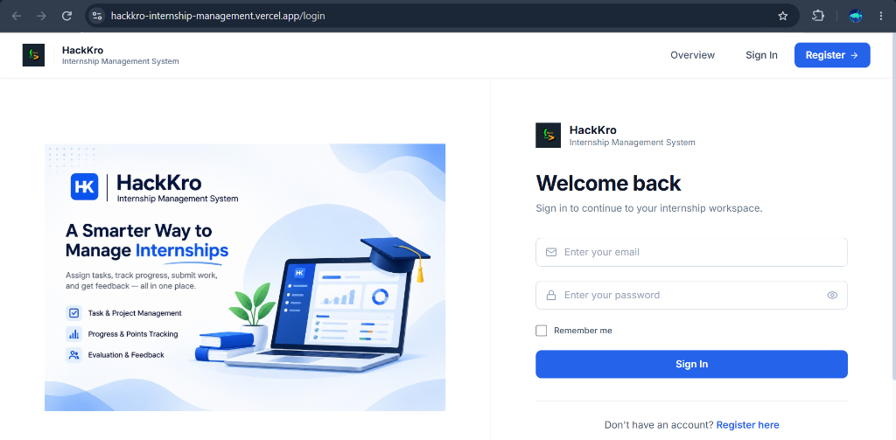
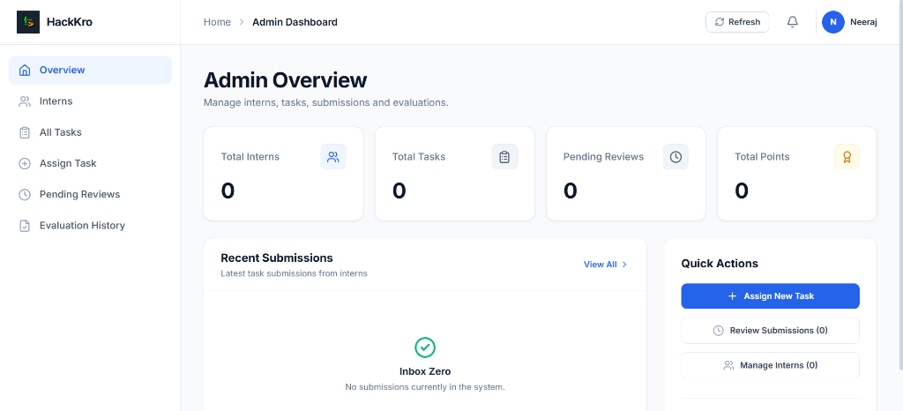

# HackKro Internship Management System

[](https://hackkro-internship-management.vercel.app)
[](https://hackkro-internship-management.vercel.app)
[](https://hackkro-internship-management.onrender.com)
[](https://www.mongodb.com/atlas)
[](https://github.com/neerajcoder1/hackkro-internship-management)
[](LICENSE)

An enterprise-grade, full-stack SaaS platform designed for software developer internship programs to manage milestone assignments, GitHub deliverables, atomic evaluations, points tracking, and automated email communications at scale.

Built for the **Unstop Software Developer Internship – Task Submission Round**.

---

### Email Notification Verification

The email notification workflow was tested successfully in the live production environment.

**Verified workflow:**
1. An intern submits a GitHub solution.
2. The backend triggers the submission notification.
3. The administrator receives the email in the configured inbox.
4. The notification includes the intern's details, GitHub submission URL, submission timestamp, notes, and Admin Review Queue link.

**Production Evidence**


*Figure: Actual production email received after an intern submitted a task.*

**Resend Sandbox Limitation**

The demonstration uses Resend's testing sender (`onboarding@resend.dev`). Its sandbox restricts delivery to the verified account owner's email address. The screenshot proves successful delivery to the configured administrator inbox; it does not prove unrestricted external email delivery.

For unrestricted production delivery, a verified custom sending domain must be configured in Resend.


## 🌐 Live Production Deployments

| Component | Service | Live Production URL | Health Status |
| :--- | :--- | :--- | :--- |
| **Frontend Application** | Vercel | [https://hackkro-internship-management.vercel.app](https://hackkro-internship-management.vercel.app) |  |
| **Backend REST API** | Render | [https://hackkro-internship-management.onrender.com](https://hackkro-internship-management.onrender.com) |  |
| **System Health Probe** | Render API | [https://hackkro-internship-management.onrender.com/api/health](https://hackkro-internship-management.onrender.com/api/health) |  |
| **GitHub Repository** | GitHub | [https://github.com/neerajcoder1/hackkro-internship-management](https://github.com/neerajcoder1/hackkro-internship-management) |  |

---

## 📖 Project Overview

The **HackKro Internship Management System** replaces ad-hoc spreadsheets, email threads, and manual scorekeeping with a unified, role-based platform. 

It provides two distinct, tailored experiences:
1. **Intern Workspace:** Where candidates view assigned daily/weekly tasks, submit public GitHub deliverables with notes, monitor review statuses, and track cumulative point scores.
2. **Administrator Command Center:** Where program directors oversee intern rosters, create and delegate milestone assignments, inspect submitted code solutions, allocate verified scores, and dispatch automated feedback.

---

## ✨ Key Features

- **Role-Based Privilege Separation (RBAC):** Strict separation between candidate interns and program directors enforced through cryptographic JWT verification.
- **Milestone Cadence Management:** Categorize assignments into **Daily Deliverables** (micro-tasks) and **Weekly Milestones** (complex projects).
- **GitHub Submission Engine:** Validates public GitHub repository URLs (`https://github.com/owner/repo`) and prevents duplicate pending submissions.
- **Atomic Point Evaluation Guard:** Eliminates race conditions in grading via atomic database updates, enforcing that awarded points never exceed the milestone's maximum allowable score.
- **Automated Lifecycle Notifications:** Powered by the Resend API with responsive, entity-escaped HTML templates for assignment alerts, submission notices, and evaluation decisions.
- **Modern White-and-Blue SaaS Design:** Clean enterprise UI inspired by Linear and Stripe, featuring responsive data tables, modals, and Lucide icons.
- **Role-Based Portal Selection (`/portals`):** Dedicated entry points for Admin/Employee staff and Intern candidates with contextual authentication banners and seamless workspace routing.
- **Comprehensive Quality Assurance:** Verified by **46 / 46 passing automated integration tests** covering auth, RBAC, evaluation integrity, edge conditions, and email resilience.

---

## 🚪 Role-Based Portal Selection (`/portals`)

HackKro provides a clear, role-delineated portal selection interface accessible directly from the navigation bar, landing page, and dedicated `/portals` route:

1. **Admin / Employee Portal (`/login?portal=admin` $\rightarrow$ `/admin`)**
   - Targeted at Program Directors, Mentors, and Staff.
   - Centralized management of candidate rosters, milestone delegation, live review queues, and point evaluations.
   - Protected against public registration; accessible exclusively via authorized credentials.

2. **Intern Portal (`/login?portal=intern` $\rightarrow$ `/intern`)**
   - Targeted at Candidates and Enrolled Interns.
   - Access to daily deliverables, weekly milestones, GitHub submission forms, and verified feedback scores.
   - Direct link to candidate registration (`/register`) for new interns.

3. **Contextual Authentication Experience**
   - Dynamic badges on the unified login screen clarify the active portal context while allowing one-click portal switching.
   - Cryptographic JWT verification and RBAC middleware guarantee that users are routed strictly according to their verified database role.

---

## 👥 Intern & Administrator Functionality

### Intern Workspace (`/intern`)
- **Real-Time Analytics:** Track Total Points Earned, Completed Tasks, Active Milestones, and Cohort Completion Rate.
- **Task Listings:** Filterable Daily and Weekly tabs detailing descriptions, deadlines, max points, and status tags (`Pending`, `Submitted`, `Completed`).
- **Submission Form:** Submit public GitHub repository URLs and technical notes with client/server validation.
- **Evaluation Feedback:** Review instructor feedback and points breakdown per submission.
- **Profile Section:** View account creation date, unique MongoDB Member ID, and verified intern role badge.

### Administrator Workspace (`/admin`)
- **Program Dashboard:** Overview metrics showing Total Interns, Total Tasks, Deliverables Awaiting Review, and Cumulative Points Awarded.
- **Intern Directory:** Searchable roster detailing candidate names, emails, enrollment dates, and completed task tallies.
- **Task Assignment Engine:** Create assignments with deadline date-pickers, point caps, and assigned intern selection.
- **Submission Review Queue:** Live queue showing pending deliverables with one-click external links to candidate GitHub repositories.
- **Evaluation Modal:** Approve or request revisions, assign verified points (0 to maxPoints), and provide structured instructor feedback.

---

## 🛠️ Technology Stack

| Layer | Technologies | Description |
| :--- | :--- | :--- |
| **Frontend** | React 18.3, Vite 6, Tailwind CSS 3, Lucide Icons | Component-driven SPA, atomic utility styling, client-side routing. |
| **Backend API** | Node.js 20+, Express 4.21 (ESM) | Decoupled RESTful architecture, centralized error mapping, rate limiting. |
| **Database** | MongoDB Atlas, Mongoose 8.9 ODM | Cloud multi-region cluster, pre-save bcrypt hashing, atomic conditional updates. |
| **Authentication** | JWT (jsonwebtoken 9.0), bcryptjs (10 salt rounds) | Stateless HMAC-SHA256 signatures, Authorization Bearer tokens. |
| **Email Service** | Resend API SDK 6.37 | Transactional email delivery with entity-escaped HTML templates. |
| **Security** | Helmet 8.3, Express Rate Limit 8.7, CORS 2.8 | Security headers, anti-brute-force rate limiting, strict origin allowlists. |
| **Cloud Hosting** | Vercel (Frontend), Render (Backend) | Edge CDN routing, SPA route rewrites (`vercel.json`), zero-downtime health probes. |

---

## 🏛️ Architecture Diagram

```
+-----------------------------------------------------------------------------------+
|                                  CLIENT LAYER                                     |
|                   React 18 SPA (Vite, Tailwind CSS, Lucide Icons)                 |
|                                                                                   |
|   +----------------------------+                 +----------------------------+   |
|   |      Intern Workspace      |                 |      Admin Workspace       |   |
|   | - Task Milestones (D/W)    |                 | - Intern Roster Directory  |   |
|   | - GitHub Submission Form   |                 | - Task Creation & Dispatch |   |
|   | - Points Score Tracker     |                 | - Submission Review Queue  |   |
|   | - Instructor Feedback Card |                 | - Points Evaluation Engine |   |
|   +----------------------------+                 +----------------------------+   |
+-----------------------------------------------------------------------------------+
                                         |
                            HTTPS / JSON / Bearer JWT
                                         v
+-----------------------------------------------------------------------------------+
|                                  SERVER LAYER                                     |
|                   Express REST API on Node.js (Render Cloud)                      |
|                                                                                   |
|   [ Helmet Security Headers ]  -->  [ Rate Limiter (500 API / 30 Auth) ]          |
|   [ CORS Origin Allowlist ]    -->  [ JWT Authentication Middleware ]             |
|   [ RBAC Role Guard ]          -->  [ Centralized Error Handler (CastError, 400) ]|
+-----------------------------------------------------------------------------------+
                  |                                               |
                  v                                               v
+-----------------------------------+           +-----------------------------------+
|          DATABASE LAYER           |           |        NOTIFICATION LAYER         |
|      MongoDB Atlas (Cluster0)     |           |            Resend API             |
|  - Users Collection (bcrypt)      |           |  - Task Assignment Alerts         |
|  - Tasks Collection (Daily/Weekly)|           |  - Submission Alerts to Admin     |
|  - Submissions Collection (Atomic)|           |  - Evaluation Decision to Intern  |
+-----------------------------------+           +-----------------------------------+
```

---

## 📸 Application Screenshots

### Unified Authentication Portal (`/login`)
*Single entry point supporting automated role detection and redirection (`/admin` for directors, `/intern` for interns).*



---

### Administrator Command Center (`/admin`)
*Real-time program metrics, quick assignment actions, intern directory, and live review queue.*



---

## 📁 Project Folder Structure

```text
HackKro-Internship-Management/
├── backend/
│   ├── server.js                      # Application bootstrap & graceful shutdown listeners
│   ├── package.json                   # Backend dependencies & npm test scripts
│   ├── package-lock.json              # Deterministic lockfile (clean, no circular refs)
│   ├── .env.example                   # Backend environment template (placeholders only)
│   ├── tests/
│   │   ├── auth.test.js               # 9 integration tests for Auth & RBAC
│   │   ├── email.test.js              # 5 integration tests for Resend Email Workflows
│   │   ├── security.test.js           # 21 integration tests for Security Hardening & Edge Cases
│   │   └── task.test.js               # 11 integration tests for Tasks, Submissions & Points
│   └── src/
│       ├── app.js                     # Express app (Helmet, Rate Limiters, CORS, routes)
│       ├── config/
│       │   └── db.js                  # MongoDB Atlas connection & error listeners
│       ├── controllers/
│       │   ├── auth.controller.js     # User registration, login, logout, me, register-admin
│       │   ├── health.controller.js   # Health probe (/api/health)
│       │   ├── task.controller.js     # Task creation, assignment, updates, deletion, my-tasks
│       │   └── submission.controller.js # Submission creation, atomic review, points calculation
│       ├── middleware/
│       │   ├── auth.middleware.js     # JWT verification (authenticate) & RBAC (authorize)
│       │   ├── errorHandler.js        # Centralized error handler (CastError, duplicate keys)
│       │   └── notFoundHandler.js     # 404 handler for undefined routes
│       ├── models/
│       │   ├── user.model.js          # User schema with pre-save bcrypt hashing (10 rounds)
│       │   ├── task.model.js          # Task schema (daily/weekly, deadlines, points)
│       │   └── submission.model.js    # Submission schema (GitHub URL, status, atomic guard)
│       ├── routes/
│       │   ├── index.js               # Master API route aggregator (/api)
│       │   ├── auth.routes.js         # /api/auth routes
│       │   ├── health.routes.js       # /api/health route
│       │   ├── task.routes.js         # /api/tasks routes
│       │   └── submission.routes.js   # /api/submissions routes
│       ├── scripts/
│       │   └── seedAdmin.js           # Idempotent administrator account seeding utility
│       ├── services/
│       │   ├── email.service.js       # Resend email client, retry & deduplication logic
│       │   └── emailTemplates.js      # Responsive HTML templates with entity-escaping (XSS safe)
│       └── utils/
│           ├── ApiError.js            # Standardized operational error class
│           ├── ApiResponse.js          # Standardized JSON response envelope
│           └── asyncHandler.js         # Async error forwarding wrapper
├── frontend/
│   ├── index.html                     # HTML5 root shell
│   ├── vercel.json                    # Vercel SPA routing rewrite rules (/(.*) -> /index.html)
│   ├── package.json                   # Frontend dependencies & Vite scripts
│   ├── package-lock.json              # Clean frontend lockfile
│   ├── .env.example                   # Frontend environment template
│   ├── tailwind.config.js             # Tailwind theme & design tokens
│   ├── vite.config.js                 # Vite build configuration
│   └── src/
│       ├── App.jsx                    # Root router with ProtectedRoute components
│       ├── main.jsx                   # React 18 DOM mount
│       ├── index.css                  # Global Tailwind directives & Inter typography
│       ├── assets/                    # Optimized branding graphics
│       ├── components/
│       │   ├── Navbar.jsx             # Responsive public header
│       │   ├── ProtectedRoute.jsx     # Client-side authentication & role-based gatekeeper
│       │   ├── layout/                # DashboardLayout with responsive sidebar & user badge
│       │   └── ui/                    # Reusable Modal, StatCard, StatusBadge, NotificationBanner
│       ├── context/
│       │   └── AuthContext.jsx        # Global authentication state, JWT hydration, login/logout
│       ├── pages/
│       │   ├── HomePage.jsx           # Public overview & landing showcase
│       │   ├── LoginPage.jsx          # Unified split-screen login page
│       │   ├── RegisterPage.jsx       # Candidate registration page (intern enforced)
│       │   ├── InternPortal.jsx       # Complete Intern Workspace & submission manager
│       │   └── AdminPortal.jsx        # Complete Administrator Command Center & review queue
│       └── services/
│           └── api.js                 # Centralized fetch client with trailing-slash normalization
└── docs/
    ├── HackKro_Project_Report.md      # Full software engineering specification report
    ├── HackKro_Project_Report.pdf     # 14-page publication-ready PDF deliverable
    └── screenshots/                   # Application captures (login, admin dashboard, branding)
```

---

## 🔒 Authentication & Security Architecture

1. **Stateless JWT Authorization:** Tokens are cryptographically signed using HMAC-SHA256 (`jwt.sign`) with expiration enforcement (`7d`).
2. **Password Security:** Salt-hashed using `bcryptjs` with 10 salt rounds. Schemas use `select: false` so password hashes are never exposed in queries or JSON responses.
3. **HTTP Security Headers (Helmet):** Configured globally in `backend/src/app.js` providing `X-Content-Type-Options: nosniff`, `X-Frame-Options: SAMEORIGIN`, `Cross-Origin-Resource-Policy: cross-origin`, and `HSTS`.
4. **Anti-Brute-Force Rate Limiting:** Global rate limit of 500 requests per 15 minutes; strict limit of 30 attempts per 15 minutes on `/api/auth/login`, `/register`, and `/register-admin`.
5. **NoSQL Injection Safeguard:** Strict primitive type checking (`typeof email === 'string' && typeof password === 'string'`) in controllers prevents query object injection.
6. **Mongoose CastError Normalization:** Centralized error handler maps malformed ObjectIds directly to `400 Bad Request` instead of unhandled 500 errors.
7. **Email HTML XSS Defense:** All dynamic parameters in email templates (`internName`, `task.title`, `submissionNotes`, `feedback`) pass through `escapeHtml()` entity encoding.
8. **Production Stack Trace Masking:** When running under `NODE_ENV=production`, internal stack traces and server directory paths are completely suppressed.

---

## 🗄️ Database Models

### 1. User Model (`users`)
- `name` (String, required, minlength: 2)
- `email` (String, required, unique, lowercase, indexed)
- `password` (String, required, minlength: 6, select: false)
- `role` (String, enum: `['intern', 'admin']`, default: `'intern'`)
- `createdAt` / `updatedAt` (Date timestamps)

### 2. Task Model (`tasks`)
- `title` (String, required, trim)
- `description` (String, required, trim)
- `taskType` (String, enum: `['daily', 'weekly']`, required)
- `assignedTo` (ObjectId $\rightarrow$ User, required, indexed)
- `assignedBy` (ObjectId $\rightarrow$ User, required)
- `deadline` (Date, required)
- `maxPoints` (Number, required, min: 1, default: 100)
- `status` (String, enum: `['pending', 'submitted', 'completed']`, default: `'pending'`)

### 3. Submission Model (`submissions`)
- `task` (ObjectId $\rightarrow$ Task, required, indexed)
- `intern` (ObjectId $\rightarrow$ User, required, indexed)
- `githubUrl` (String, required, validated via GitHub regex)
- `submissionNotes` (String, trim, default: `''`)
- `status` (String, enum: `['submitted', 'approved', 'rejected']`, default: `'submitted'`)
- `pointsAwarded` (Number, default: 0, min: 0)
- `feedback` (String, trim, default: `''`)
- `reviewedBy` (ObjectId $\rightarrow$ User)
- `submittedAt` (Date, default: Date.now)
- `reviewedAt` (Date)
- `isEvaluated` (Boolean, default: false)

---

## 📡 REST API Documentation

### Base URL: `https://hackkro-internship-management.onrender.com/api`

| Method | Endpoint | Access Level | Description | Status Codes |
| :--- | :--- | :--- | :--- | :--- |
| `GET` | `/health` | Public | System health probe & DB connectivity check | `200` |
| `POST` | `/auth/register` | Public | Register new intern account (role locked to intern) | `201`, `400`, `409` |
| `POST` | `/auth/login` | Public | Authenticate user credentials & issue JWT | `200`, `400`, `401` |
| `POST` | `/auth/logout` | Authenticated | Invalidate local session | `200` |
| `GET` | `/auth/me` | Authenticated | Retrieve authenticated user profile & role | `200`, `401` |
| `GET` | `/auth/interns` | Admin Only | Retrieve roster of all enrolled intern accounts | `200`, `401`, `403` |
| `POST` | `/auth/register-admin` | Master Key | Provision administrator account via `x-admin-key` | `201`, `400`, `403` |
| `GET` | `/tasks/my-tasks` | Intern Only | Retrieve milestones assigned to authenticated intern | `200`, `401` |
| `POST` | `/tasks` | Admin Only | Create milestone assignment and dispatch email alert | `201`, `400`, `403` |
| `GET` | `/tasks` | Admin Only | Retrieve all created milestone assignments | `200`, `401`, `403` |
| `GET` | `/tasks/:id` | Authenticated | Retrieve milestone specifications by ID | `200`, `400`, `404` |
| `PATCH`| `/tasks/:id` | Admin Only | Update task deadline, points cap, or description | `200`, `400`, `403` |
| `DELETE`| `/tasks/:id` | Admin Only | Delete milestone assignment | `200`, `403`, `404` |
| `POST` | `/submissions` | Intern Only | Submit GitHub solution URL for assigned task | `201`, `400`, `403` |
| `GET` | `/submissions/my-submissions`| Intern Only| Retrieve submission history for authenticated intern | `200`, `401` |
| `GET` | `/submissions/my-points`| Intern Only | Calculate and return cumulative points breakdown | `200`, `401` |
| `GET` | `/submissions` | Admin Only | Retrieve review queue with status/task filters | `200`, `401`, `403` |
| `PATCH`| `/submissions/:id/review`| Admin Only | Evaluate submission, allocate points, provide feedback | `200`, `400`, `403` |

---

## 📧 Automated Email Notification Workflows (Resend)

The system integrates the **Resend API** for automated communications across three critical lifecycle milestones:

1. **Task Assignment Notification:** Triggered when an admin creates a task. Intern receives task title, cadence, deadline, max points, and workspace CTA link.
2. **Task Submission Alert:** Triggered when an intern submits work. Admin receives candidate name, email, task title, GitHub URL, notes, and review queue link.
3. **Evaluation Decision Notification:** Triggered when an admin evaluates a submission. Intern receives the outcome (`APPROVED` or `REVISION REQUESTED`), score breakdown (`85 / 100 Points`), instructor feedback notes, and dashboard CTA.

---

## ⚙️ Environment Variables

### Backend Configuration (`backend/.env`)
```env
# Server Configuration
PORT=5000
NODE_ENV=development

# Database Configuration (MongoDB Atlas or Local MongoDB)
MONGODB_URI=mongodb+srv://<username>:<password>@cluster0.abcde.mongodb.net/hackkro_internship?retryWrites=true&w=majority

# Security & CORS
CORS_ORIGIN=http://localhost:5173

# Authentication
JWT_SECRET=development_jwt_secret_change_in_production
JWT_EXPIRES_IN=7d
ADMIN_CREATION_KEY=hackkro_super_secret_admin_key_2026

# Automated Email Notifications (Resend API)
RESEND_API_KEY=re_your_resend_api_key_here
EMAIL_FROM=HackKro Internship <onboarding@resend.dev>
ADMIN_NOTIFICATION_EMAIL=admin@hackkro.com
FRONTEND_URL=http://localhost:5173
```

### Frontend Configuration (`frontend/.env`)
```env
# Frontend API Base URL
VITE_API_BASE_URL=http://localhost:5000/api
```

---

## 💻 Local Installation & Setup

### Prerequisites
- Node.js (v18.0.0 or higher)
- npm (v9.0.0 or higher)
- Local MongoDB or free MongoDB Atlas account

### 1. Clone Repository & Install Dependencies
```bash
git clone https://github.com/neerajcoder1/hackkro-internship-management.git
cd hackkro-internship-management

# Install backend dependencies cleanly
cd backend && npm ci

# Install frontend dependencies cleanly
cd ../frontend && npm ci
```

### 2. Configure Environment Files
Copy the example templates and add your credentials:
```bash
cp backend/.env.example backend/.env
cp frontend/.env.example frontend/.env
```

### 3. Start Development Servers
In terminal 1 (Backend API):
```bash
npm --prefix backend run dev
```

In terminal 2 (Frontend Client):
```bash
npm --prefix frontend run dev
```

Open your browser to: **[http://localhost:5173](http://localhost:5173)**

---

## 🧪 Testing Instructions & Verified Results

The backend includes a comprehensive automated test suite executed with Node.js's native test runner (`node --test`):

```bash
npm --prefix backend test
```

### Latest Verified Results: **46 / 46 Tests Passing (100% Pass Rate)**
```
▶ Phase 2 Authentication and Role-Based Authorization Tests (9 tests)
  ✔ 1. Successful intern registration
  ✔ 2. Duplicate email rejection (409 Conflict)
  ✔ 3. Successful login & JWT issuance
  ✔ 4. Incorrect password rejection (401 Unauthorized)
  ✔ 5. Missing token rejection on protected route (401 Unauthorized)
  ✔ 6. Invalid token rejection on protected route (401 Unauthorized)
  ✔ 7. GET /api/auth/me retrieves authenticated user
  ✔ 8. Intern attempting admin access is rejected (403 Forbidden)
  ✔ 9. Admin registration via private key and accessing authorized admin route (200 OK)

▶ Phase 5 Automated Email Notification Workflows (5 tests)
  ✔ 1. Task Assignment Email Workflow: Admin creates task triggers intern email
  ✔ 2. Task Submission Email Workflow: Intern submits solution triggers admin notification
  ✔ 3. Task Evaluation Email Workflow: Admin review decision triggers intern notification
  ✔ 4. Duplicate Notification Prevention: Resending same notification key is skipped
  ✔ 5. Resilience & Failure Handling: Invalid email or missing parameters do not throw

▶ Phase 7 Comprehensive Security Hardening & QA Test Suite (21 tests)
  ✔ 1.1. Missing token returns 401 Unauthorized
  ✔ 1.2. Malformed / invalid token signature returns 401 Unauthorized
  ✔ 1.3. Expired token is detected and rejected with 401 Unauthorized
  ✔ 1.4. Wrong password returns 401 Unauthorized without leaking account existence detail
  ✔ 1.5. Duplicate registration returns 409 Conflict
  ✔ 1.6. Security headers (Helmet) are present on API responses
  ✔ 2.1. Intern accessing admin-only endpoint (GET /api/tasks) returns 403 Forbidden
  ✔ 2.2. Intern attempting to create tasks (POST /api/tasks) returns 403 Forbidden
  ✔ 2.3. Intern attempting to update tasks (PATCH /api/tasks/:id) returns 403 Forbidden
  ✔ 2.4. Intern attempting to delete tasks (DELETE /api/tasks/:id) returns 403 Forbidden
  ✔ 2.5. Intern Bob submitting work for Intern Alice task is rejected with 403 Forbidden
  ✔ 2.6. Intern attempting to evaluate a submission returns 403 Forbidden
  ✔ 3.1. Invalid task ID format returns 400 Bad Request (handled CastError)
  ✔ 3.2. Invalid deadline format during task creation returns 400 Bad Request
  ✔ 3.3. Invalid GitHub URL format during submission returns 400 Bad Request
  ✔ 3.4. Duplicate submission while review is pending is rejected with 400 Bad Request
  ✔ 4.1. Awarding points exceeding task maxPoints returns 400 Bad Request
  ✔ 4.2. Awarding negative points returns 400 Bad Request
  ✔ 4.3. Admin successfully reviews and approves with valid points (85/100)
  ✔ 4.4. Duplicate point awards on already approved submission is strictly rejected (400)
  ✔ 5.1. Missing email fields or invalid recipient gracefully handled without throwing

▶ Phase 3 Task Management & Evaluation Integration Tests (11 tests)
  ✔ 1. Admin task creation (POST /api/tasks)
  ✔ 2. Unauthorized task creation (Intern attempting POST /api/tasks is rejected with 403)
  ✔ 3. Intern task access & assignment verification (GET /api/tasks/my-tasks)
  ✔ 4. Submission ownership protection (Intern B cannot submit for Intern A task)
  ✔ 5. Valid submission creation by assigned intern (POST /api/submissions)
  ✔ 6. Duplicate submission rejection while review is pending (POST /api/submissions)
  ✔ 7. Validation prevents awarding points exceeding task maxPoints
  ✔ 8. Admin review and approval with point allocation (PATCH /api/submissions/:id/review)
  ✔ 9. Duplicate point prevention (Attempting to re-evaluate approved submission is rejected)
  ✔ 10. Point calculation accuracy (GET /api/submissions/my-points)
  ✔ 11. Intern submission history retrieval (GET /api/submissions/my-submissions)

Summary:
ℹ tests 46
ℹ suites 9
ℹ pass 46
ℹ fail 0
ℹ duration_ms ~13.2s
```

### Frontend Production Build
```bash
npm --prefix frontend run build
# vite v6.4.5 building for production...
# ✓ 2089 modules transformed.
# dist/index.html                     0.48 kB │ gzip:  0.32 kB
# dist/assets/index-B4elT-eA.css     31.55 kB │ gzip:  6.14 kB
# dist/assets/index-BXJPtq3y.js     288.98 kB │ gzip: 76.49 kB
# ✓ built in 3.53s
```

---

## 🚀 Production Deployment Architecture

- **Frontend:** Hosted on **Vercel** connected to the GitHub repository. Configured with [`frontend/vercel.json`](frontend/vercel.json) rewrite rules (`/(.*)` $\rightarrow$ `/index.html`) ensuring clean browser page reloads without 404s.
- **Backend API:** Hosted on **Render** as a Node.js web service running in production mode (`NODE_ENV=production`) with dynamic port binding, zero-downtime health probing (`/api/health`), and CORS origin allowlists.
- **Database:** Hosted on **MongoDB Atlas** (Cloud Replica Set M0) with SSL encryption and IP access configuration.
- **Email Delivery:** Configured via **Resend API** with HTML template escaping.

---

## 🔮 Future Enhancements & Roadmap

- [ ] **GitHub Webhook Integration:** Ingest commit hashes, pull requests, and CI test results directly from candidate repositories.
- [ ] **Distributed Redis Deduplication:** Transition in-memory email deduplication sets to a distributed Redis key-value store with TTL for clustered deployments.
- [ ] **Plagiarism & Code Similarity Detection:** Automated source code similarity analysis across cohort submissions.
- [ ] **Automated PDF Transcripts:** One-click generation of verifiable internship completion certificates and score transcripts.

---

## 📄 Documentation & Project Report

- **Comprehensive Technical Report (Markdown):** [`docs/HackKro_Project_Report.md`](docs/HackKro_Project_Report.md)
- **Publication-Ready Project Report (PDF):** [`docs/HackKro_Project_Report.pdf`](docs/HackKro_Project_Report.pdf)

---

## 📄 License

This project is licensed under the ISC License.
